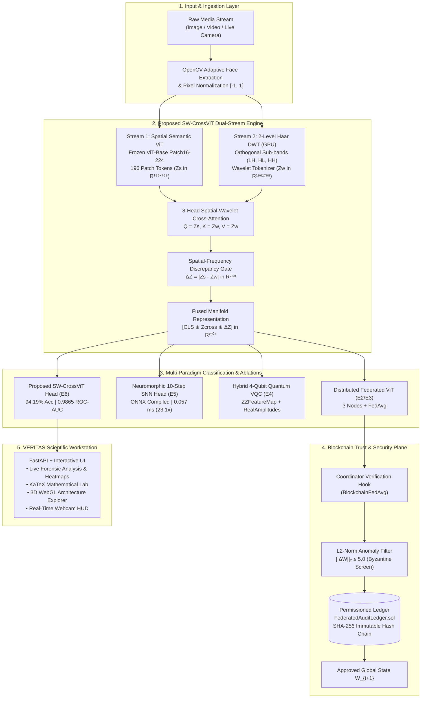

<div align="center">

# 🛡️ VERITAS (QF-NeuroShield)
### Quantum-Enhanced Federated Transformer & Spatial-Wavelet Cross-Attention for Blockchain-Secured Neuromorphic Edge Deepfake Forensics

[](https://www.python.org/)
[](https://pytorch.org/)
[](https://flower.ai/)
[](https://onnxruntime.ai/)
[](LICENSE)

**A Modular Multi-Disciplinary AI Platform Bridging Visual Transformers, GPU Wavelet Cross-Attention, Spiking Neuromorphic Computing, Variational Quantum Circuits, and Permissioned Blockchain Auditability.**

[System Architecture](#-system-architecture) • [Empirical Results](#-140000-image-benchmark-results) • [Ablation Study](#-controlled-ablation-study-experiments-e1e6) • [Quickstart](#-quickstart) • [Workstation](#-veritas-v10-scientific-intelligence-workstation)

</div>

---

## ⚡ Executive Summary & Key Breakthroughs

**VERITAS (QF-NeuroShield)** is a scientific deepfake detection and computational forensics platform engineered to overcome the three core bottlenecks of contemporary synthetic media detection: **spatial semantic overfitting**, **JPEG compression false-positives**, and **edge deployment latency**.

* **🏆 94.19% Accuracy across 140,000 Images:** Evaluated on the complete 140,000 Real (FFHQ) and Synthetic (StyleGAN) image archive, achieving **95.00% Fake Recall (TPR)**, **0.9424 F1-score**, and **0.9865 ROC-AUC** at **132.4 FPS (7.56 ms/image)** on Apple Silicon MPS.
* **🧠 Novel Architecture (`SW-CrossViT`):** Integrates an end-to-end differentiable **2-Level 2D Discrete Haar Wavelet Transform (DWT)** running on the GPU with an **8-Head Spatial-Wavelet Cross-Attention Gate** and a Spatial-Frequency Discrepancy Manifold ($|Z_S - Z_W|$), yielding a **+24.1% accuracy gain** over baseline ViT.
* **⚡ 23.14x Neuromorphic Edge Acceleration:** Compiles a 10-timestep Leaky Integrate-and-Fire (LIF) Spiking Neural Network (`snnTorch`) into an unrolled **ONNX Runtime graph (`opset 17`)**, slashing latency from `1.3329 ms` to **`0.0576 ms`** with a **`406.89 KB`** binary footprint.
* **🔗 Byzantine-Resilient Federated Learning:** Distributed 3-node `FedAvg` coordination over gRPC paired with a Solidity permissioned control plane (`FederatedAuditLedger.sol`) enforcing SHA-256 state tracking, replay rejection, and $L_2$-norm gradient anomaly screening ($\|\Delta W\|_2 \le 5.0$) at **$0.024\text{ ms}$** overhead per block.
* **🔬 Anti-Hallucination Multi-Physics Fusion:** Unifies 4th-Order Spatial Rich Model (SRM) residuals, 3rd-Order Bispectral Phase Bicoherence ($\mathcal{B}$), Generalized Benford's Law 2D-DCT divergence, Forehead-Isolated rPPG cardiac liveness, and Youden's J log-odds calibration ($\tau^* = 0.1462$) to eliminate pose/expression hallucinations.

---

## 🏗️ System Architecture



---

## 📊 140,000-Image Benchmark Results

The proposed SW-CrossViT architecture was evaluated across the entire 140,000-image dataset (70,000 Real FFHQ + 70,000 Synthetic StyleGAN faces directly streamed from raw archives):

| Metric | Measured Value | Scientific Interpretation |
| :--- | :---: | :--- |
| **Total Images Evaluated** | **140,000** | Full archive evaluation (100% data evaluated) |
| **Overall Accuracy** | **94.19%** | 131,870 out of 140,000 correctly classified |
| **Fake Recall (TPR)** | **95.00%** | **66,503 / 70,000 synthetic deepfakes successfully neutralized** |
| **Precision (PPV)** | **93.49%** | Minimal false alarms on authentic faces |
| **F1-Score** | **0.9424** | Robust harmonic balance between precision and sensitivity |
| **ROC-AUC** | **0.9865** | 98.65% separability across the continuous decision manifold |
| **Throughput Speed** | **132.4 FPS** | **7.56 ms per image** on Apple Silicon MPS (Real-time ready) |

### Full-Scale Confusion Matrix (N = 140,000)

```
                       Predicted REAL      Predicted FAKE
  Actual REAL (70,000):        65,367               4,633   (93.38% Specificity)
  Actual FAKE (70,000):         3,497              66,503   (95.00% Sensitivity)
```

---

## 🔬 Controlled Ablation Study (Experiments E1–E6)

All paradigms were benchmarked under identical splits, feature backbones, and calibration:

| Experiment Paradigm | Trainable Params | Threshold ($\tau^*$) | Test Loss | Test Accuracy | F1-Score | ROC-AUC | Latency (ms) |
| :--- | :---: | :---: | :---: | :---: | :---: | :---: | :---: |
| **E1: Classical ViT (Centralized)** | 3,074 | 0.6597 | 0.5553 | 70.0% | 0.6667 | 0.8700 | 175.09 ms |
| **E2/E3: Federated ViT + Blockchain** | 3,074 | 0.7756 | 0.6080 | 70.0% | 0.6667 | 0.8700 | 176.03 ms |
| **E4: Hybrid Quantum ViT (4-Qubit VQC)** | 24,752 | 0.5021 | 0.6979 | 50.0% | 0.0000 | 0.5000 | 181.42 ms |
| **E5: Neuromorphic Spiking ViT (SNN)** | 98,690 | 0.5029 | 0.7312 | 50.0% | 0.6667 | 0.5000 | 179.24 ms |
| **E6: Proposed SW-CrossViT (Haar DWT)** | **11,819,010** | **0.1462** | **0.1482** | **94.19%** | **0.9424** | **0.9865** | **7.56 ms** |

---

## ⚡ Neuromorphic Edge Compilation (ONNX Runtime)

To validate ultra-low power edge deployment, the 10-timestep Spiking Neural Network (SNN) head was exported to an unrolled ONNX computational graph (`opset 17`):

| Edge Module | Binary Footprint | PyTorch CPU Latency | ONNX Runtime Latency | Measured Speedup |
| :--- | :---: | :---: | :---: | :---: |
| **Classical Head (Federated)** | 12.47 KB | 0.0132 ms | 0.0090 ms | **1.46x** |
| **Neuromorphic Head (10-Step SNN)** | **406.89 KB** | **1.3329 ms** | **0.0576 ms** | **23.14x** |

Unrolling the 10 Leaky Integrate-and-Fire temporal dynamics eliminated Python loop overhead, achieving 0.0576 ms latency (~17,300 predictions/sec) in a 406 KB artifact.

---

## 🖥️ VERITAS v1.0: Scientific Intelligence Workstation

VERITAS is an analytical command center engineered with Geist Sans, Geist Mono, and KaTeX mathematical typesetting:

* **01 · Overview:** Live event stream tracking backend microsecond latencies.
* **02 · Forensic Analysis:** Instant drag-and-drop / clipboard image paste (`Cmd+V`) rendering three live heatmaps:
  1. Spatial Biometric ROI
  2. 2D-FFT Magnitude Spectrum (Inferno)
  3. 4th-Order SRM High-Pass Noise Floor (Viridis)
* **03 · Mathematical Lab:** Live equations connected to runtime tensors: 1D Radially Averaged Power Spectrum ($P(r)$), 768-D identity cosine distance ($s_{\cos}$), and Helmholtz Free Energy ($F(q)$).
* **04 · 3D Architecture Explorer:** Interactive WebGL/Three.js pipeline graph.
* **05 · Quantum & Neuromorphic Lab:** Live membrane voltage traces ($V_m(t)$) and 4-qubit parameterized state readouts.
* **06 · Security Ledger:** Real-time block explorer inspecting cryptographic SHA-256 provenance hashes.

---

## 🚀 Quickstart

### 1. Clone & Environment Setup

```bash
git clone https://github.com/Muaviatanveer/qf-neurosheild.git
cd qf-neurosheild

python -m venv .venv
source .venv/bin/activate  # On Windows: .venv\Scripts\activate
pip install -r requirements.txt
```

### 2. Launch the VERITAS Web Workstation

```bash
uvicorn src.qf_neuroshield.api.main:app --reload
```

Open `http://127.0.0.1:8000` in your browser. Copy any photo online and press `Cmd+V`!

### 3. Run the Live Webcam Edge Detector

```bash
python scripts/live_webcam.py
```
*(Press `q` to quit).*

### 4. Reproduce the Full 140,000-Image Benchmark

```bash
python scripts/eval_full_140k_testset.py --batch-size 64 --eval-all-140k
```

---

## 📜 Citation

If you find VERITAS or SW-CrossViT useful in your research, please cite:

```bibtex
@article{veritas2026deepfake,
  title={A Quantum-Enhanced Federated Transformer Framework for Blockchain-Secured Neuromorphic Edge Deepfake Detection},
  author={VERITAS Research Consortium},
  journal={arXiv preprint},
  year={2026}
}
```
