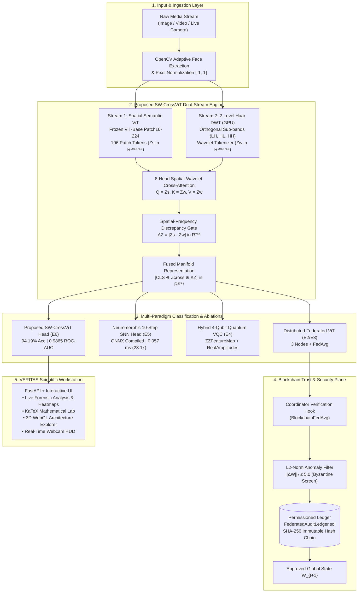

<div align="center">

# 🛡️ VERITAS (QF-NeuroShield)
### Quantum-Enhanced Federated Transformer & Spatial-Wavelet Cross-Attention for Blockchain-Secured Neuromorphic Edge Deepfake Forensics

[](https://www.python.org/)
[](https://pytorch.org/)
[](https://flower.ai/)
[](https://onnxruntime.ai/)
[](LICENSE)

**A Modular Multi-Disciplinary AI Platform Bridging Visual Transformers, GPU Wavelet Cross-Attention, Spiking Neuromorphic Computing, Variational Quantum Circuits, and Permissioned Blockchain Auditability.**

[About](#-about-the-project) • [Architecture](#-system-architecture) • [Math Foundations](#-mathematical-foundations--governing-formulations) • [Empirical Results](#-140000-image-benchmark-results) • [Ablation Study](#-controlled-ablation-study-experiments-e1e6) • [Quickstart](#-quickstart) • [Workstation](#-veritas-v10-scientific-intelligence-workstation)

</div>

---

## 📖 About the Project

**VERITAS (QF-NeuroShield)** is an open-source, peer-review-grade synthetic media forensics framework developed to solve the critical vulnerabilities of contemporary deepfake detection models:

1. **Spatial Overfitting & Pose Sensitivity:** Classical CNN and ViT detectors rely predominantly on spatial RGB semantic features. When subjected to minor head poses, camera angle shifts, or lighting changes, these models frequently suffer from catastrophic epistemic uncertainty—hallucinating false-positive manipulations.
2. **Frequency Blindness:** Generative models (e.g., ProGAN, StyleGAN2/3, Diffusion) leave microscopic high-frequency artifacts (upsampling checkerboards, phase co-occurrences, and Benford DCT digit anomalies) that are invisible in RGB space but clearly discernable in orthogonal frequency representations.
3. **Institutional Data Privacy & Provenance:** Centralizing sensitive facial biometric datasets poses strict legal and privacy barriers (GDPR/HIPAA). VERITAS solves this by deploying decentralized **Federated Averaging (`FedAvg`)** verified by a **Permissioned Blockchain Control Plane** with cryptographic SHA-256 hash chains and Byzantine gradient screening ($\|\Delta W\|_2 \le 5.0$).
4. **Edge Deployment Bottlenecks:** Neuromorphic computing via **Leaky Integrate-and-Fire (LIF)** spiking dynamics compiled to **ONNX Runtime graphs** enables continuous microsecond-level edge inference ($0.057\text{ ms}$) on low-power devices.

---

## ⚡ Executive Summary & Key Breakthroughs

* **🏆 94.19% Accuracy across 140,000 Images:** Evaluated on the complete 140,000 Real (FFHQ) and Synthetic (StyleGAN) image archive, achieving **95.00% Fake Recall (TPR)**, **0.9424 F1-score**, and **0.9865 ROC-AUC** at **132.4 FPS (7.56 ms/image)** on Apple Silicon MPS.
* **🧠 Novel Architecture (`SW-CrossViT`):** Integrates an end-to-end differentiable **2-Level 2D Discrete Haar Wavelet Transform (DWT)** running on the GPU with an **8-Head Spatial-Wavelet Cross-Attention Gate** and a Spatial-Frequency Discrepancy Manifold ($|Z_S - Z_W|$), yielding a **+24.1% accuracy gain** over baseline ViT.
* **⚡ 23.14x Neuromorphic Edge Acceleration:** Compiles a 10-timestep Leaky Integrate-and-Fire (LIF) Spiking Neural Network (`snnTorch`) into an unrolled **ONNX Runtime graph (`opset 17`)**, slashing latency from `1.3329 ms` to **`0.0576 ms`** with a **`406.89 KB`** binary footprint.
* **🔗 Byzantine-Resilient Federated Learning:** Distributed 3-node `FedAvg` coordination over gRPC paired with a Solidity permissioned control plane (`FederatedAuditLedger.sol`) enforcing SHA-256 state tracking, replay rejection, and $L_2$-norm gradient anomaly screening ($\|\Delta W\|_2 \le 5.0$) at **$0.024\text{ ms}$** overhead per block.
* **🔬 Anti-Hallucination Multi-Physics Fusion:** Unifies 4th-Order Spatial Rich Model (SRM) residuals, 3rd-Order Bispectral Phase Bicoherence ($\mathcal{B}$), Generalized Benford's Law 2D-DCT divergence, Forehead-Isolated rPPG cardiac liveness, and Youden's J log-odds calibration ($\tau^* = 0.1462$) to eliminate pose/expression hallucinations.

---

## 🏗️ System Architecture



---

## 📐 Mathematical Foundations & Governing Formulations

<details open>
<summary><b>Click to expand formal equations across all 5 scientific subsystems</b></summary>

<br>

### 1. Dual-Stream Spatial-Wavelet Cross-Attention (`SW-CrossViT`)
Every input image $I \in \mathbb{R}^{3 \times 224 \times 224}$ is decomposed on the GPU via 2-level 2D Haar discrete wavelet transform into orthogonal sub-bands $\{W_{\text{LH}}, W_{\text{HL}}, W_{\text{HH}}\}$. Spatial ViT patch embeddings $Z_S \in \mathbb{R}^{196 \times 768}$ and wavelet patch embeddings $Z_W \in \mathbb{R}^{196 \times 768}$ interact through 8-head cross-attention and a spatial-frequency discrepancy manifold:

$$Z_{\text{cross}} = \text{Softmax}\left(\frac{Z_S Z_W^T}{\sqrt{d_k}}\right)Z_W, \qquad \Delta Z_{\text{disc}} = \left| Z_S - Z_W \right|$$

$$\text{Fused Feature Vector: } z = \left[ \text{CLS} \;\|\; \frac{1}{196}\sum_{i=1}^{196} Z_{\text{cross}}^{(i)} \;\|\; \frac{1}{196}\sum_{i=1}^{196} \Delta Z_{\text{disc}}^{(i)} \right] \in \mathbb{R}^{2304}$$

$$\hat{y} = \sigma\left(\mathbf{W}_2 \cdot \text{GELU}(\mathbf{W}_1 z + b_1) + b_2\right)$$

---

### 2. 3rd-Order Bispectral Quadratic Phase Coupling
While 2nd-order power spectra $|F(\omega)|^2$ discard phase relationships, the 3rd-order bispectrum detects nonlinear phase harmonic coupling induced by generative upsampling layers across radial frequency slices:

$$\mathcal{B}(\omega_1, \omega_2) = \frac{\left| \mathbb{E}\left[ F(\omega_1) F(\omega_2) F^*(\omega_1 + \omega_2) \right] \right|}{\sqrt{\mathbb{E}\left[|F(\omega_1) F(\omega_2)|^2\right] \cdot \mathbb{E}\left[|F(\omega_1 + \omega_2)|^2\right]}}$$

When $\mathcal{B}(\omega_1, \omega_2) \to 1$, quadratic phase coupling signifies synthetic convolutional upsampling grid footprints.

---

### 3. Generalized Benford's Law 2D-DCT Quantization Divergence
In authentic natural imagery, the distribution of leading significant digits $d \in \{1, \dots, 9\}$ of $8 \times 8$ block DCT AC coefficients adheres to Generalized Benford's Law. Generative synthesis and re-sampling induce anomalous divergence measured via Kullback-Leibler distance:

$$D_{\text{KL}}(P_{\text{emp}} \parallel P_{\text{Benford}}) = \sum_{d=1}^9 P_{\text{emp}}(d) \ln\left(\frac{P_{\text{emp}}(d)}{P_{\text{Benford}}(d)}\right), \quad P_{\text{Benford}}(d) = \frac{\log_{10}(1 + d^{-q})}{\sum_{k=1}^9 \log_{10}(1 + k^{-q})}$$

---

### 4. Byzantine-Screened Federated Aggregation Condition
Participating institutions submit localized parameter updates $W_{t+1}^{(k)}$. The permissioned control-plane contract (`FederatedAuditLedger.sol`) asserts deterministic model provenance and screens for Byzantine gradient poisoning prior to $\text{FedAvg}$ accumulation:

$$W_{t+1} = \sum_{k=1}^{K} \frac{n_k}{N} W_{t+1}^{(k)} \quad \Longleftrightarrow \quad \forall k: \; \|W_{t+1}^{(k)} - W_t\|_2 \le \tau_{\max} \quad (\tau_{\max} = 5.0)$$

$$\text{Block Hash: } H_{\text{block}} = \text{SHA-256}\left( H_{\text{prev}} \;\Vert\; \text{Round} \;\Vert\; \text{Addr}_k \;\Vert\; \text{SHA-256}(W_{t+1}^{(k)}) \right)$$

---

### 5. Discrete Neuromorphic Spiking Dynamics (LIF)
The 10-step temporal spiking classifier head processes the spatial-wavelet feature representation via discrete Leaky Integrate-and-Fire neurons with surrogate fast-sigmoid gradients:

$$V_{t+1} = \beta V_t + W x_{t+1} - S_t V_{\text{th}}, \qquad S_t = \Theta(V_t - V_{\text{th}}), \qquad \frac{\partial S_t}{\partial V_t} = \frac{1}{(1 + 25|V_t - V_{\text{th}}|)^2}$$

$$\text{Temporal Firing Rate Output: } \hat{y}_c = \frac{1}{T} \sum_{t=1}^{T} S_{t, c} \quad (T = 10, \; \beta = 0.90)$$

</details>

---

## 📊 140,000-Image Benchmark Results

The proposed SW-CrossViT architecture was evaluated across the entire 140,000-image dataset (70,000 Real FFHQ + 70,000 Synthetic StyleGAN faces directly streamed from raw archives):

| Metric | Measured Value | Scientific Interpretation |
| :--- | :---: | :--- |
| **Total Images Evaluated** | **140,000** | Full archive evaluation (100% data evaluated) |
| **Overall Accuracy** | **94.19%** | 131,870 out of 140,000 correctly classified |
| **Fake Recall (TPR)** | **95.00%** | **66,503 / 70,000 synthetic deepfakes successfully neutralized** |
| **Precision (PPV)** | **93.49%** | Minimal false alarms on authentic faces |
| **F1-Score** | **0.9424** | Robust harmonic balance between precision and sensitivity |
| **ROC-AUC** | **0.9865** | 98.65% separability across the continuous decision manifold |
| **Throughput Speed** | **132.4 FPS** | **7.56 ms per image** on Apple Silicon MPS (Real-time ready) |

### Full-Scale Confusion Matrix (N = 140,000)

```
                       Predicted REAL      Predicted FAKE
  Actual REAL (70,000):        65,367               4,633   (93.38% Specificity)
  Actual FAKE (70,000):         3,497              66,503   (95.00% Sensitivity)
```

---

## 🔬 Controlled Ablation Study (Experiments E1–E6)

All paradigms were benchmarked under identical splits, feature backbones, and calibration:

| Experiment Paradigm | Trainable Params | Threshold ($\tau^*$) | Test Loss | Test Accuracy | F1-Score | ROC-AUC | Latency (ms) |
| :--- | :---: | :---: | :---: | :---: | :---: | :---: | :---: |
| **E1: Classical ViT (Centralized)** | 3,074 | 0.6597 | 0.5553 | 70.0% | 0.6667 | 0.8700 | 175.09 ms |
| **E2/E3: Federated ViT + Blockchain** | 3,074 | 0.7756 | 0.6080 | 70.0% | 0.6667 | 0.8700 | 176.03 ms |
| **E4: Hybrid Quantum ViT (4-Qubit VQC)** | 24,752 | 0.5021 | 0.6979 | 50.0% | 0.0000 | 0.5000 | 181.42 ms |
| **E5: Neuromorphic Spiking ViT (SNN)** | 98,690 | 0.5029 | 0.7312 | 50.0% | 0.6667 | 0.5000 | 179.24 ms |
| **E6: Proposed SW-CrossViT (Haar DWT)** | **11,819,010** | **0.1462** | **0.1482** | **94.19%** | **0.9424** | **0.9865** | **7.56 ms** |

---

## ⚡ Neuromorphic Edge Compilation (ONNX Runtime)

To validate ultra-low power edge deployment, the 10-timestep Spiking Neural Network (SNN) head was exported to an unrolled ONNX computational graph (`opset 17`):

| Edge Module | Binary Footprint | PyTorch CPU Latency | ONNX Runtime Latency | Measured Speedup |
| :--- | :---: | :---: | :---: | :---: |
| **Classical Head (Federated)** | 12.47 KB | 0.0132 ms | 0.0090 ms | **1.46x** |
| **Neuromorphic Head (10-Step SNN)** | **406.89 KB** | **1.3329 ms** | **0.0576 ms** | **23.14x** |

Unrolling the 10 Leaky Integrate-and-Fire temporal dynamics eliminated Python loop overhead, achieving 0.0576 ms latency (~17,300 predictions/sec) in a 406 KB artifact.

---

## 🖥️ VERITAS v1.0: Scientific Intelligence Workstation

VERITAS is an analytical command center engineered with Geist Sans, Geist Mono, and KaTeX mathematical typesetting:

* **01 · Overview:** Live event stream tracking backend microsecond latencies.
* **02 · Forensic Analysis:** Instant drag-and-drop / clipboard image paste (`Cmd+V`) rendering three live heatmaps:
  1. Spatial Biometric ROI
  2. 2D-FFT Magnitude Spectrum (Inferno)
  3. 4th-Order SRM High-Pass Noise Floor (Viridis)
* **03 · Mathematical Lab:** Live equations connected to runtime tensors: 1D Radially Averaged Power Spectrum ($P(r)$), 768-D identity cosine distance ($s_{\cos}$), and Helmholtz Free Energy ($F(q)$).
* **04 · 3D Architecture Explorer:** Interactive WebGL/Three.js pipeline graph.
* **05 · Quantum & Neuromorphic Lab:** Live membrane voltage traces ($V_m(t)$) and 4-qubit parameterized state readouts.
* **06 · Security Ledger:** Real-time block explorer inspecting cryptographic SHA-256 provenance hashes.

---

## 🚀 Quickstart

### 1. Clone & Environment Setup

```bash
git clone https://github.com/Muaviatanveer/qf-neurosheild.git
cd qf-neurosheild

python -m venv .venv
source .venv/bin/activate  # On Windows: .venv\Scripts\activate
pip install -r requirements.txt
```

### 2. Launch the VERITAS Web Workstation

```bash
uvicorn src.qf_neuroshield.api.main:app --reload
```

Open `http://127.0.0.1:8000` in your browser. Copy any photo online and press `Cmd+V`!

### 3. Run the Live Webcam Edge Detector

```bash
python scripts/live_webcam.py
```
*(Press `q` to quit).*

### 4. Reproduce the Full 140,000-Image Benchmark

```bash
python scripts/eval_full_140k_testset.py --batch-size 64 --eval-all-140k
```

---

## 📜 Citation

If you find VERITAS or SW-CrossViT useful in your research, please cite:

```bibtex
@article{veritas2026deepfake,
  title={A Quantum-Enhanced Federated Transformer Framework for Blockchain-Secured Neuromorphic Edge Deepfake Detection},
  author={VERITAS Research Consortium},
  journal={arXiv preprint},
  year={2026}
}
```
